# OMP Desktop

A native desktop app for [oh-my-pi](https://github.com/can1357/oh-my-pi) (`omp`), the terminal coding agent.
Every tab runs its own `omp` process in RPC mode; the app shows what the agent is doing as it happens: streamed replies, tool calls, diffs, subagents, plans and what it costs.
Built on Tauri 2 (Rust + the system webview). It doesn't bundle Electron or load anything from a CDN; chat needs no browser.

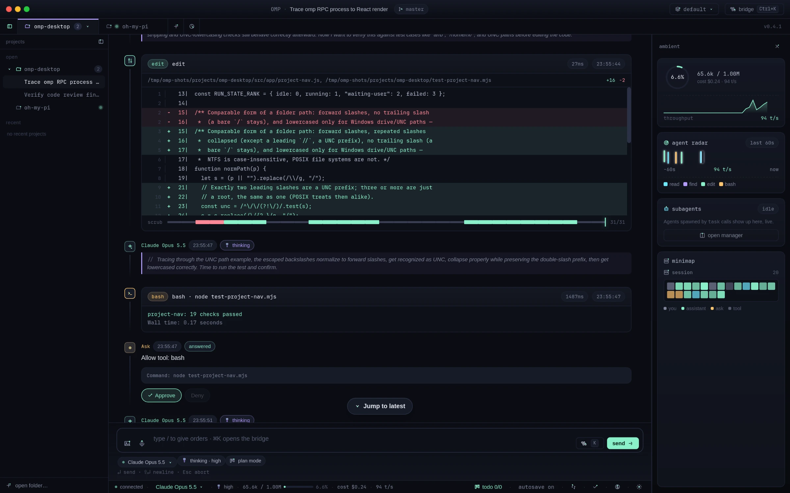

## Contents

- [Features](#features)
- [Install](#install)
- [Usage](#usage)
- [Development](#development)
- [Architecture](#architecture)
- [License](#license)

## Features

### Projects and tabs

- **One tab = one agent.** Each tab is its own `omp` process, with its own working folder and profile. Switching tabs keeps in-flight turns streaming in the background.
- **Project sidebar** (`Ctrl+B`): open tabs grouped by project, plus recently opened folders. Tabs on the same folder collapse into one tab-bar chip with a dropdown. Drag a project or a conversation in the tab bar, the dropdown or the sidebar to reorder it; the order is kept across restarts.
- **Named conversations.** A new tab starts under its folder name and renames itself to the conversation's generated title once the first exchange ends. A `/rename` you type always wins.
- **Conversation history** (`Ctrl+H`): search and resume saved sessions. If the conversation is already open in a tab, that tab is focused instead of opening it twice.
- **Open with OMP Desktop.** Open a folder from Finder, Explorer or your Linux file manager, or run `omp-desktop /path/to/project`. If the app is already running, the folder opens as a new tab in the existing window.
- **Welcome screen.** With no tab open, the app shows a welcome screen and doesn't run any agent until you open a project.

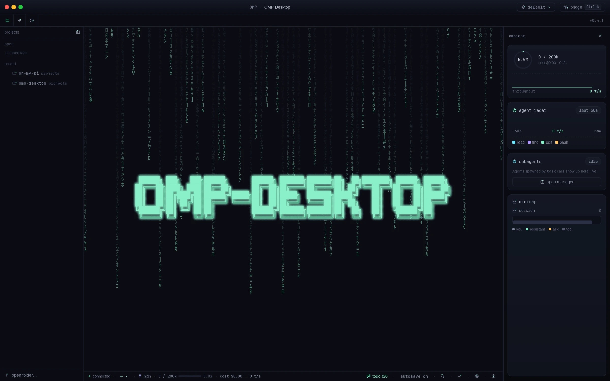

### Watching the agent work

- **Tool cards** for every call: `read`, `grep`, `bash`, `eval` (JS/Python kernel cells), `edit`, `task` and more. Output streams live, code is syntax-highlighted, edit diffs have a scrubber, and the file path on an edit card opens the git browser on that file.
- **Approvals.** The tool approval mode is chosen in the approvals panel (toolbar ✓) or in Settings → Approvals: `always ask`, `write` (the default) or `yolo`, for all projects or one project. Exec-tier tools ask first in `write`. Answer *Approve*, *Allow for this session* or *Always allow in this project*, and review or revoke the saved rules in the approvals panel. A change restarts the tab's agent, and the conversation continues; a tab that is working switches when its turn ends. The toolbar shows the mode in use.
- **Ambient rail.** Shows the context-window gauge, cost, a tokens/sec sparkline, an agent radar of recent tool activity, and a minimap of the session. Click a minimap cell to jump to that message. Show or hide each card under Settings → Rail.
- **Changes card.** With the [GitHub CLI](https://cli.github.com/) (`gh`) installed and signed in, the rail shows the open GitHub PR for the project's checked-out branch: title, diff counts and its CI checks, each opening its CI page. Its menu has an opt-in **Auto-fix**, off by default and per tab: when CI fails or a reviewer leaves an unresolved comment, it prompts the agent to fix, verify, commit and push, and resolve the threads it addressed. Your tool approvals still apply. Without `gh` the card stays hidden.
- **Subagent manager.** Agents started by a `task` call appear in the rail as they run. Open the manager to get totals, a swimlane timeline, agents grouped by the task call that spawned them, and an inspector for each agent's assignment, tools, output and transcript.

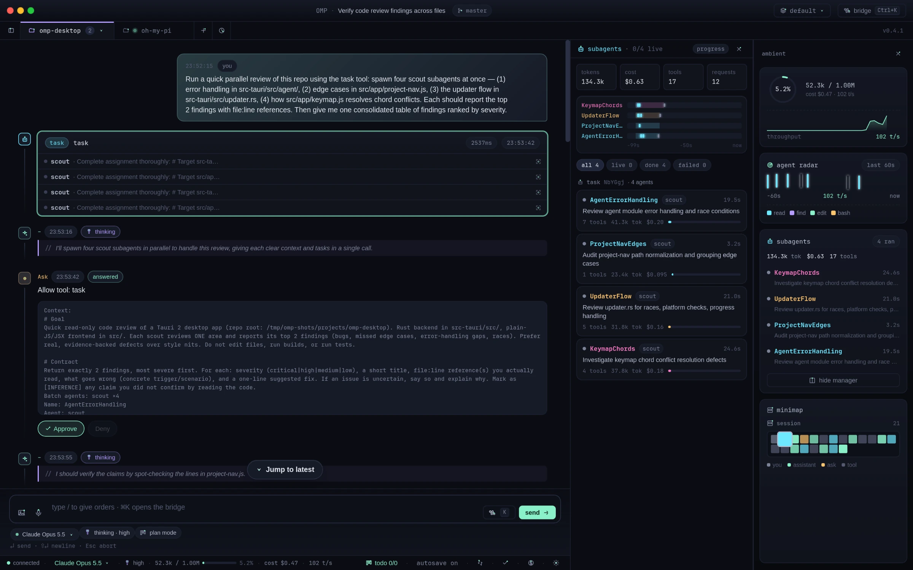

### Browser panel

Open the globe button in the toolbar, `Ctrl+Shift+B` or `/browser [url]` to see and use the same browser the tab's agent drives. The panel follows the page the agent works in, has page tabs, back/forward/reload and an address field, and can be resized or switched to full view (a toolbar button beside the globe while the panel is open). Mouse, scroll, keyboard, paste and IME input reach the page; the toggle-browser, toggle-terminal and next/previous-tab shortcuts, `⌘` shortcuts and, outside macOS, `Ctrl+Shift` shortcuts still reach the app. **Annotate** (the pencil beside the globe while the panel is open) picks an element or a dragged area: add a comment, and the chip goes out with your next message, goal included, as text plus a screenshot of the area. Localhost links in chat open in the panel by default (`⌘`/`Ctrl`+click opens your normal browser). The ambient rail hides while the panel is open.

The panel needs a Chromium-based browser on your computer: Google Chrome, Chromium, Edge, Brave, or the Chrome for Testing omp downloads (snap packages can't be used). The app finds one itself; Settings → Browser lists what it found and lets you pick another program. Each tab gets its own headless browser, started the first time the tab needs it, with a fresh throwaway profile: no extensions, nothing from your normal browser profile, and gone when you close the tab or quit. Pages run in that browser, never in the app's own window. The agent drives the page you are looking at: it doesn't open a tab of its own, so its navigation replaces your page. Internals and the local trust boundary: [`docs/architecture/browser.md`](docs/architecture/browser.md).

Your annotation comments are instructions; what comes from the page (URL, selector, text, HTML) is marked as untrusted page content, and command or skill names and `@file` mentions in it are made harmless, so a page can't give the agent commands or make it read your files.

### Rail widgets

Put your own cards in the rail, next to the built-in ones:

- **Widget plugins.** Any program, in any language, that prints JSON: status, numbers, progress, key/value rows, text, lists and links. List it in `widgets.json` and the desktop runs it for every project it matches, when you switch to the tab, when a turn ends, when the branch changes, on a timer or from its refresh button. A list item can add its text to your prompt or open a link. Nothing runs until you approve the plugin's exact command and script in the rail, and a change to either asks again. Examples in [`examples/widgets/`](examples/widgets/): a git card, an MCP tool call, and `hello` scripts in Python and Node.
- **omp extension widgets.** What an omp extension shows with `ctx.ui.setStatus` and `ctx.ui.setWidget` appears as rail cards marked `extension`, per tab, including updates from a tab in the background.

Setup, the output format and the trust model: [`docs/widgets.md`](docs/widgets.md).

| | |
|---|---|
| **Results**: git status, CI runs and open issues; the `+` on an issue added it to the prompt | **Approval**: a plugin's command, one argument per line, before it ever runs; below, two cards from an omp extension |
|  |  |

### Plan mode

Toggle plan mode (`Shift+Alt+P`, `/plan` or the composer pill) and the agent drafts a plan before touching any files. Click any block of the plan to comment on it; your comments go back with the next *send feedback*, and *approve* lets the agent start. The agent's todo list fills the kanban (`/todo`).

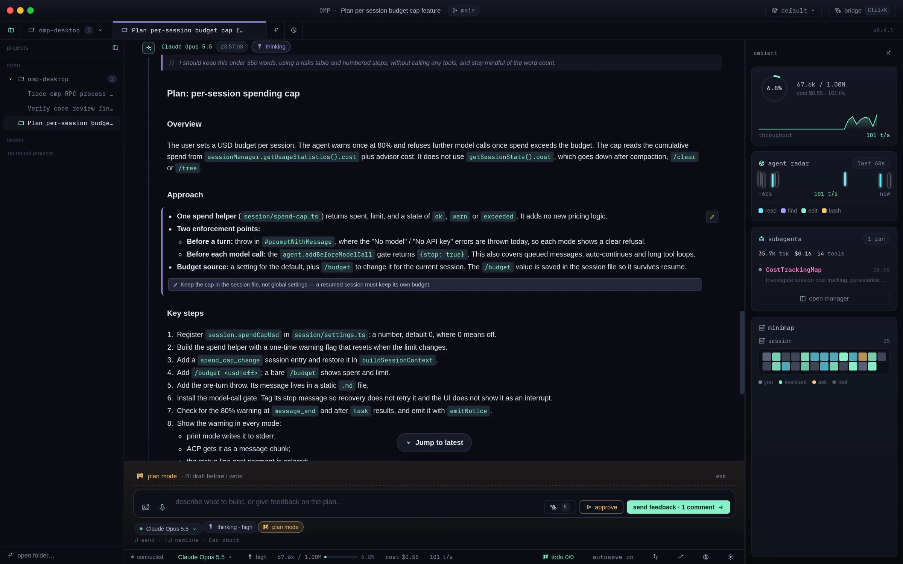

### Composer

- `/` opens a palette with the desktop commands plus every omp slash command and skill discovered for the tab.
- `@` autocompletes project file paths.
- Attach images from a file picker or paste them from the clipboard. Click an attached image to view it full size.
- Prompt history: `↑` in an empty prompt box recalls earlier prompts (`↓` goes back), and `Ctrl+↑` opens a searchable picker.
- Send while the agent is working to *steer* the current turn, or queue a follow-up with `Ctrl+Enter` (or `Ctrl+Q`). Settings → Composer can make `Ctrl+Enter` the send key instead of `Enter`; the other one then adds a new line.
- Model picker and thinking level (`off · minimal · low · medium · high · xhigh`) are available from the composer or the keyboard.
- The composer has separate one-click **Voice to text** (microphone) and **Live conversation** (speech bubble with an audio waveform) buttons. Live conversation talks to the agent, with connection state, microphone/speaker levels, captions, mute, pause, resume and end controls. `/live` starts, ends an active call, or resumes a paused one; explicit `/live start`, `/live pause`, `/live resume`, `/live stop`, `/live mute` and `/live unmute` are also available. It is Codex only: it needs an OpenAI Codex login in the tab's profile (`/login` → ChatGPT Plus/Pro), and without one its button is greyed out, with a tooltip saying so.
- Switching tabs or opening Settings **pauses live conversation** and turns off its microphone and speaker. Returning shows **Resume**, never an automatically reopened microphone. Each connection receives the current coding-chat history and the tab's earlier spoken discussion, so starting mid-chat or reconnecting does not start from a blank conversation. End stops audio without forgetting the spoken discussion in that tab. Voice history stays in memory until a new coding conversation, profile change, tab close or app restart. Context is bounded: the original objective, compacted summaries and recent exchanges take priority; omitted/truncated history is marked for the voice agent. Private thinking and image/audio payloads are not sent as history.
- Voice to text uses the tab profile's configured omp speech-to-text engine. Speak, then stop to append the transcript to that tab's existing draft; nothing is sent unless Settings → Composer → **Send voice to text on stop** is on, which sends the draft when you stop it yourself. Recording also stops by itself after a pause in your speech (Settings → Composer → **Stop voice to text after a pause**, 3 s by default, `off` to disable); with both on, dictation is hands-free. The composer shows recording/transcribing state, a preview and any error. Dictation stops before switching tabs or opening Settings; if stopping either mode fails, the tab stays visible so you can retry. On macOS, allow OMP Desktop under System Settings → Privacy & Security → Microphone.

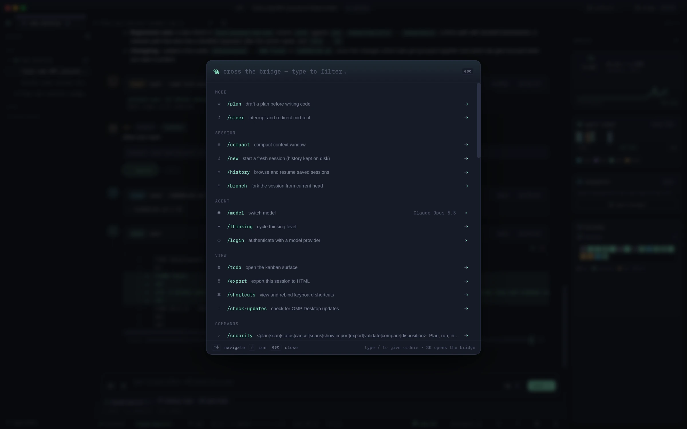

### Git browser

`Ctrl+Shift+G`, the git button in the toolbar, or the file path on an edit card opens the tab's repository over the whole window: the project tree with every changed file marked (modified, added, deleted, renamed, untracked; ignored files left out) and a switch to show only those; the selected file in full with its uncommitted change inline — staged and unstaged together, against the last commit — with jump-between-changes, stage, discard and copy; and the commit graph of every branch, remote and tag, your uncommitted work on top and the branch's lead over its upstream. Click a commit to browse it: the files it changed, each shown as of that commit. The view refreshes by itself when the agent edits a file, when the branch changes and after a stage or discard. The app reads the repository itself (through [gix](https://github.com/GitoxideLabs/gitoxide)); only stage and discard run `git`.


### Panels

| | |
|---|---|
| **Usage**: requests, cost, tokens and throughput for the last 24 h, by model, folder and agent type (from `omp stats`) | **History**: saved conversations for the tab's profile, searchable and resumable |
| 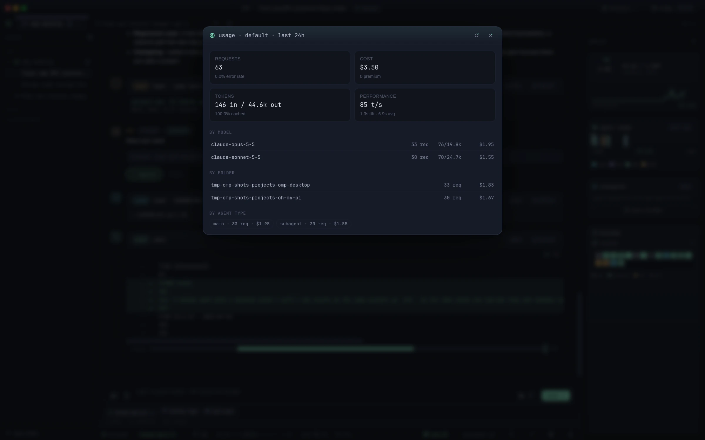 | 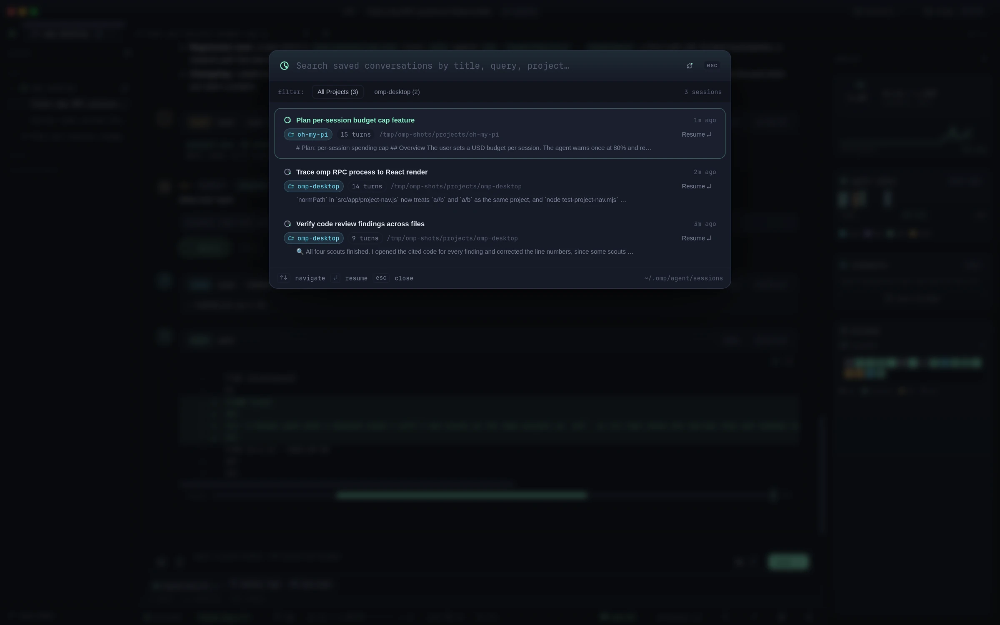 |

### Terminal

A real shell in every tab. `` Ctrl+` `` (`` ⌘` `` on macOS), the toolbar button or `/terminal` opens a panel above the prompt, in the tab's project folder, running your login shell (or the one set under Settings → Terminal, which the app saves). Hiding the panel keeps the shell running; closing the tab ends it and everything it started. After `exit`, press Enter in the panel to start a new one. It is your terminal, not the agent's: it runs with your full rights, omp's approvals do not apply to it, and nothing passes between it and the agent.

### Profiles, updates, look

- **Profiles.** A tab can run under an omp profile (`omp --profile <id>`) with its own auth, sessions, settings and caches. Create, rename and switch profiles from the toolbar, and tick one as the startup default. A new profile boots far enough to run `/login`.
- **In-app updates.** The app checks the signed release feed 15 s after launch and every 6 h after that. Windows, macOS and the Linux AppImage install updates themselves and relaunch. `.deb`/`.rpm` and source builds show a notice with a link to the release instead.
- **Settings** (the cog in the toolbar, `Ctrl+,` or `/settings`) opens as a tab after your project tabs, with a search over every setting. Sections: Appearance (theme `aurora`, `phosphor` or `daylight`, accent colour, density, font size, mono chat font), Layout (side column, what new tabs show beside the chat, column widths), Chat (folding, follow new output), Composer (send key, paste collapse length, prompt-history size), Rail, Terminal (shell, scrollback), Browser, Agent (startup profile, goal auto-continue, auto-compaction, retrying failed requests), Session (reopen tabs on launch, ask before closing a working tab, name tabs automatically, updates), Approvals and Shortcuts. Changes apply at once; a dot marks a changed setting, and each one or a whole section can be reset.

| phosphor | daylight |
|---|---|
| 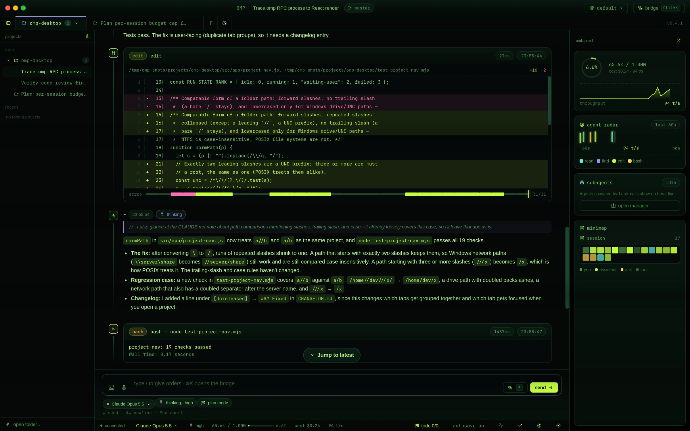 | 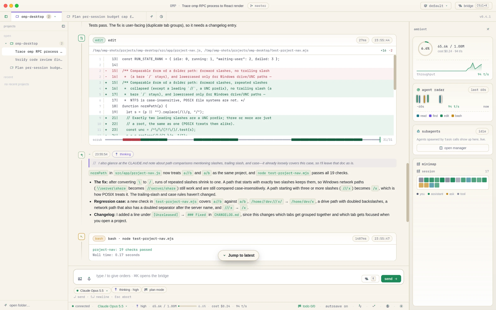 |

### Remote access

Settings → Remote access lets a phone on your network (or VPN) open the app's tabs in its browser: read the active tab live, answer the agent's questions, send, steer and stop, and, with the page added to the home screen, get a push notification when a question waits or a long turn finishes. It is off until you enable it, listens only on the network interface you choose, pairs a phone with a one-time QR code, and each phone can be revoked. Use a generated certificate or your own (push needs one the phone trusts); macOS and Linux only. Internals and the security model: [`docs/architecture/remote-access.md`](docs/architecture/remote-access.md).

### Security

- Agent output is rendered as Markdown, with any raw HTML escaped. Links open in your system browser, and `javascript:`/`data:` links are rendered as plain text.
- Release builds use a strict Content Security Policy: no inline scripts, no `eval`, the asset protocol off and the shell plugin removed.
- Tokens, API keys and auth headers are redacted from agent output and logs.
- Closing a tab or quitting kills the agent's whole process tree, so no orphaned subagents or tool processes are left behind.

## Install

### Requirements

`omp` must be installed and on your `PATH` (on Windows it is usually `%LOCALAPPDATA%\omp\omp.exe`). Each release needs a recent omp: a tab started against an older one does not start, and its message names the version required (`omp update` fixes it). On macOS, GUI apps get a minimal `PATH`, so the app also looks in Homebrew, `~/.local/bin` and `~/.cargo/bin`.

Optional: the [GitHub CLI](https://cli.github.com/) (`gh`), signed in with `gh auth login`, for the Changes card. It is found the same way as `omp`.

### Download

Grab the latest build from [Releases](https://github.com/apoc/omp-desktop/releases/latest):

| Platform | Package |
|---|---|
| Windows x64 | `*_x64-setup.exe` (NSIS) or `*_x64_en-US.msi` |
| macOS Apple Silicon / Intel | `*_aarch64.dmg` / `*_x64.dmg` |
| Linux x64 | `*.AppImage`, `*.deb`, `*.rpm` |

The installers are not code-signed with a publisher certificate yet (no Authenticode signature, no Apple notarisation). On Windows, SmartScreen warns the first time you run the app. The macOS app is only ad-hoc signed, so on first launch macOS says it "could not verify" OMP Desktop: open **System Settings → Privacy & Security** and click **Open Anyway**. Updates are still verified against the app's own minisign key.

macOS releases up to 0.10.0 are not signed at all, and on Apple Silicon macOS refuses to open them with "OMP Desktop is damaged and can't be opened". The app is not damaged; remove the download's quarantine flag and open it again:

```sh
xattr -dr com.apple.quarantine "/Applications/OMP Desktop.app"
```

## Usage

Open a folder with the `+` button (or `Ctrl+T`), from the sidebar's recent projects, or with your OS's "Open with". Then talk to the agent. Conversations are stored by omp itself, per profile, so the history panel also lists sessions you started in a terminal.

### Keyboard shortcuts

On macOS, `Ctrl+K`, `Ctrl+H`, `Ctrl+/`, `Ctrl+,`, `Ctrl+B`, `Ctrl+T`, `Ctrl+W`, `Ctrl+Shift+G`, `Ctrl+Shift+B`, `` Ctrl+` `` and `Ctrl+↑` also work with `⌘`. All shortcuts can be rebound in Settings → Shortcuts (`Ctrl+/`): every action with its chord; rebind, add a second chord, or reset. Your overrides are stored in `<app config>/keybindings.json`, and omp's own `~/.omp/agent/keybindings.yml` is used as the base layer. With the terminal or a browser-panel page focused, only the toggle-terminal, toggle-browser and next/previous-tab shortcuts (whatever they are bound to), `⌘` shortcuts and, outside macOS, `Ctrl+Shift` shortcuts reach the app; `Ctrl+T`, `Ctrl+W`, `Ctrl+C`, `Esc` and other `Ctrl`/`Alt` keys stay with the shell or the page. Copy and paste in the terminal with `Ctrl+Shift+C` / `Ctrl+Shift+V` (`⌘C` / `⌘V` on macOS).

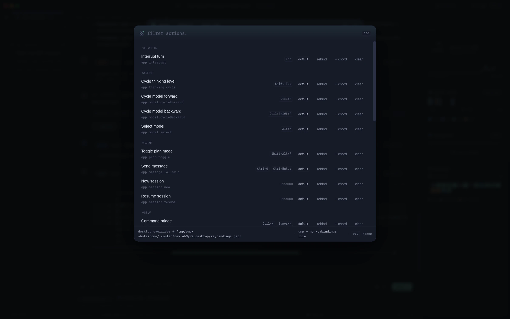

| Action | Default |
|---|---|
| Command bridge | `Ctrl+K` |
| Conversation history | `Ctrl+H` |
| Settings / Settings → Shortcuts | `Ctrl+,` / `Ctrl+/` |
| Toggle project sidebar | `Ctrl+B` |
| Toggle browser panel | `Ctrl+Shift+B` |
| New tab / close tab | `Ctrl+T` / `Ctrl+W` |
| Toggle terminal | `` Ctrl+` `` |
| Git browser | `Ctrl+Shift+G` |
| Next / previous tab | `Ctrl+Tab` / `Ctrl+Shift+Tab` |
| Move the tab's project left / right | `Ctrl+Shift+PageUp` / `Ctrl+Shift+PageDown` |
| Prompt history picker | `Ctrl+↑` |
| Interrupt the turn | `Esc` |
| Cycle thinking level | `Shift+Tab` |
| Cycle model / pick model | `Ctrl+P` (`Ctrl+Shift+P` back) / `Alt+M` |
| Toggle plan mode | `Shift+Alt+P` |
| Queue a follow-up | `Ctrl+Enter` or `Ctrl+Q` |

The approvals, usage, kanban, compact, export and update-check actions have no default chord. You can bind one in Settings → Shortcuts.

### Slash commands

The desktop adds `/plan`, `/steer`, `/compact`, `/new`, `/history`, `/branch`, `/model`, `/thinking`, `/login`, `/live [start|pause|resume|stop|mute|unmute]`, `/todo`, `/export`, `/settings`, `/shortcuts`, `/browser [url]` and `/check-updates`. Everything else omp offers (`/rename`, `/mcp`, `/skill:<name>`, …) shows up in the same palette.

## Development

| Tool | Version |
|---|---|
| [Rust](https://rustup.rs/) | stable |
| [Node.js](https://nodejs.org/) | 18+ |
| Tauri 2 system dependencies | see [Tauri prerequisites](https://tauri.app/start/prerequisites/) (WebKitGTK 4.1 on Linux, WebView2 on Windows) |

```bash
git clone https://github.com/apoc/omp-desktop
cd omp-desktop
npm install            # Tauri CLI only
npm run dev            # serves src/ as is; JSX is compiled in the webview by Babel
npm run build          # precompiles src/ into dist/ and bundles installers
```

There is no bundler. In dev, `src/index.html` loads every script in dependency order and `@babel/standalone` transpiles the JSX in the page. Release builds embed `dist/`, written by `scripts/build-frontend.mjs`: the JSX is compiled ahead of time with the same vendored Babel, and React's production build is used.

| Check | Command |
|---|---|
| All JS regression scripts (+ `dist/` build) | `npm test` |
| Rust tests | `cd src-tauri && cargo test --locked` |
| Rust lint (must stay clean) | `cd src-tauri && cargo +nightly clippy --all-targets --all-features -- -W clippy::pedantic -W clippy::nursery -D warnings` |
| Probe omp's RPC surface directly | `node tests/test-rpc.mjs` |

CI and every release run the same suite: `cargo test` on Windows, Linux and macOS, plus `npm test`.
Contributor rules (script load order, the IIFE rule, CSP constraints, clone discipline in Rust, the changelog workflow) are in [`AGENTS.md`](AGENTS.md). User-facing changes are recorded in [`CHANGELOG.md`](CHANGELOG.md).

## Architecture

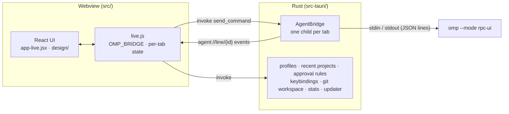

- **Rust** (`src-tauri/src/`): `agent/` spawns and supervises one `omp` per tab. That covers process groups and job objects, so a tab's whole tree dies with it; bounded stdout/stderr readers; and a per-session journal that replays what a background tab missed. Around it are small modules for profiles, recent projects, approval rules, keybindings, the git working tree, `omp stats`, saved sessions, OS folder-open requests and the updater.
- **Bridge** (`src/live.js`): all the RPC traffic. It keeps a registry of tabs, snapshots each tab's live state when you switch away, and exposes `window.OMP_BRIDGE` to React. `src/adapter.js` holds the pure transforms from RPC shapes to UI shapes.
- **UI** (`src/app-live.jsx`, `src/app/`, `src/design/`): React 19 without a bundler. Pure logic (keymap, project navigation, subagent reducer, updater state, session-title gates, …) lives in plain `src/app/*.js` modules, which the regression scripts in `tests/` load directly.

## License

[MIT](LICENSE)
